# Experiment-Predictium

[](LICENSE)
[](VERSION)
[](https://eu4mofs.com/)
[](https://github.com/abscienceai/Experiment-Predictium)
[](https://doi.org/10.5281/zenodo.18215803)

> **Open-source, no-code scientific machine-learning software for experimental data prediction, model benchmarking, uncertainty-aware analysis, high-throughput screening, inverse design, and inter-laboratory reproducibility.**

Experiment-Predictium is a Windows desktop application designed to make practical machine learning accessible to experimental researchers who work with tabular scientific data but do not necessarily write machine-learning code. The platform combines data preparation, model comparison, prediction, interpretability, reproducibility tools, materials-informatics workflows, and exportable scientific outputs in a single interface.

The MOF-specific development of Experiment-Predictium was substantially advanced during the 2026 Virtual Mobility activity **“MOF-Predictium: A No-Code Machine Learning Platform for MOF Property Prediction, Benchmarking, and High-Throughput Screening Using CoRE MOF DB”** within **COST Action CA22147 – EU4MOFs**.

**Current release:** `v2.3.0-VM-RR`

---

## Contents

- [Why Experiment-Predictium?](#why-experiment-predictium)
- [Main capabilities](#main-capabilities)
- [Machine-learning models](#machine-learning-models)
- [MOF-Predictium](#mof-predictium)
- [MOF VM Tools](#mof-vm-tools)
- [MOF-NP Round-Robin and Inter-Laboratory Reproducibility](#mof-np-round-robin-and-inter-laboratory-reproducibility)
- [How to combine data returned by independent laboratories](#how-to-combine-data-returned-by-independent-laboratories)
- [Typical scientific workflows](#typical-scientific-workflows)
- [Screenshots](#screenshots)
- [Installation](#installation)
- [Reproducibility](#reproducibility)
- [Data resources and CoRE MOF](#data-resources-and-core-mof)
- [Broader research relevance](#broader-research-relevance)
- [Scientific scope and limitations](#scientific-scope-and-limitations)
- [COST Action CA22147 / EU4MOFs support](#cost-action-ca22147--eu4mofs-support)
- [Repository structure](#repository-structure)
- [Citation](#citation)
- [Author](#author)
- [License](#license)

---

# Why Experiment-Predictium?

Experimental researchers increasingly generate datasets that could benefit from machine learning, but the practical workflow is often fragmented across spreadsheets, Python notebooks, model-specific scripts, plotting tools, and manual reporting.

Experiment-Predictium was developed to provide a **single no-code workflow** for:

**experimental table → data quality → model comparison → prediction → interpretation → uncertainty / OOD checks → screening / optimisation → reproducible outputs**

The platform is intentionally not restricted to a single scientific field. Its original use cases span experimental science and engineering, while the EU4MOFs Virtual Mobility work introduced a dedicated materials-informatics layer for **metal-organic frameworks (MOFs)**.

The design philosophy is simple:

> **Do not hide model disagreement or data limitations. Make them visible to the researcher.**

The software therefore emphasises comparative benchmarking, metadata-aware validation, uncertainty, out-of-distribution detection, provenance, and reproducible export rather than presenting a single model prediction as unquestionable ground truth.

---

# Main capabilities

## 1. No-code prediction from experimental tabular data

Users can load Excel-based experimental datasets, select a machine-learning algorithm, train a model, and generate predictions through the desktop interface without writing Python code.

Key functions include:

- Excel data loading;
- parameter/target selection;
- single-model training and prediction;
- trained-model saving and reloading;
- custom algorithm/model loading;
- structured output folders;
- prediction metadata preservation.

<!-- SCREENSHOT: save as image/screenshots/01_main_interface.png -->
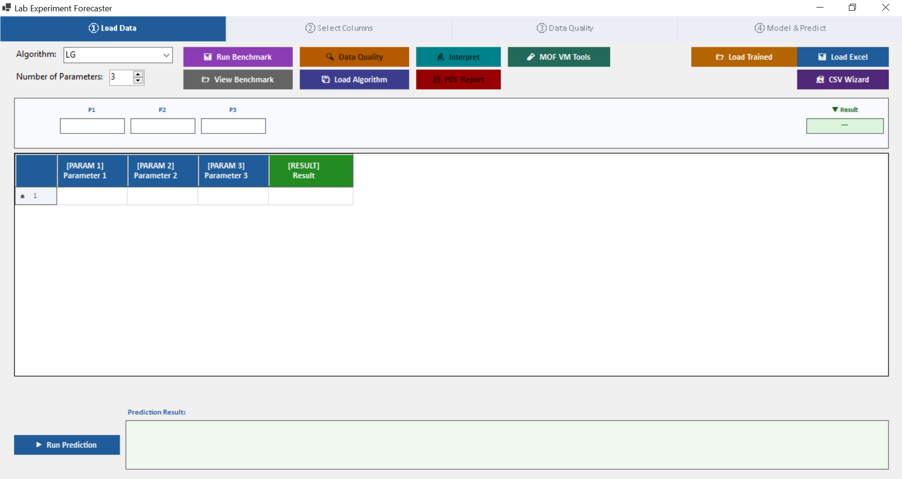

**Figure 1. Main Experiment-Predictium interface.** The primary workflow provides data loading, algorithm selection, prediction, benchmarking, data-quality analysis, interpretation, reporting, model persistence, and access to the MOF VM Tools.

---

## 2. Data Quality panel

The Data Quality workflow helps researchers inspect a dataset before model training.

Functions include:

- per-column statistics;
- missing-value percentages;
- visual quality indicators;
- drop / mean-fill / median-fill strategies;
- cleaned-data handoff to downstream analysis.

<!-- SCREENSHOT: save as image/screenshots/02_data_quality.png -->
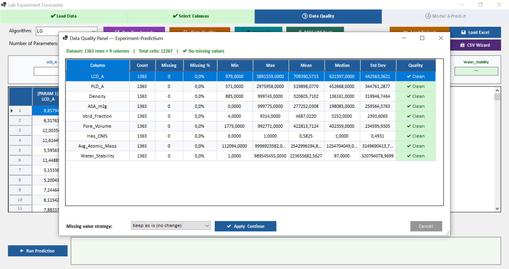

**Figure 2. Data Quality panel.** Data cleaning decisions are made explicitly before model comparison or prediction.

---

## 3. CSV-to-Excel preparation wizard

A guided preparation wizard supports researchers whose source datasets arrive as CSV files.

The workflow includes:

1. load CSV;
2. select columns;
3. convert boolean fields;
4. manage missing values;
5. rename columns;
6. export a prepared Excel dataset.

<!-- SCREENSHOT: save as image/screenshots/03_csv_wizard.png -->
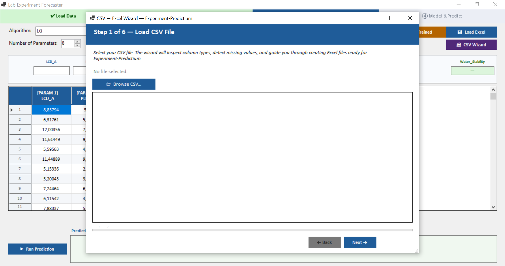

---

## 4. Multi-model benchmarking

Experiment-Predictium compares multiple algorithms under the same dataset and evaluation workflow rather than assuming one architecture is universally superior.

The current benchmark reports:

- **RMSE** – root mean squared error;
- **MAE** – mean absolute error;
- **MAPE** – mean absolute percentage error;
- **R²** – coefficient of determination;
- training/execution time;
- **80/20 holdout performance**;
- **5-fold cross-validation mean ± standard deviation**.

<!-- SCREENSHOT: save as image/screenshots/04_benchmark_8_models.png -->
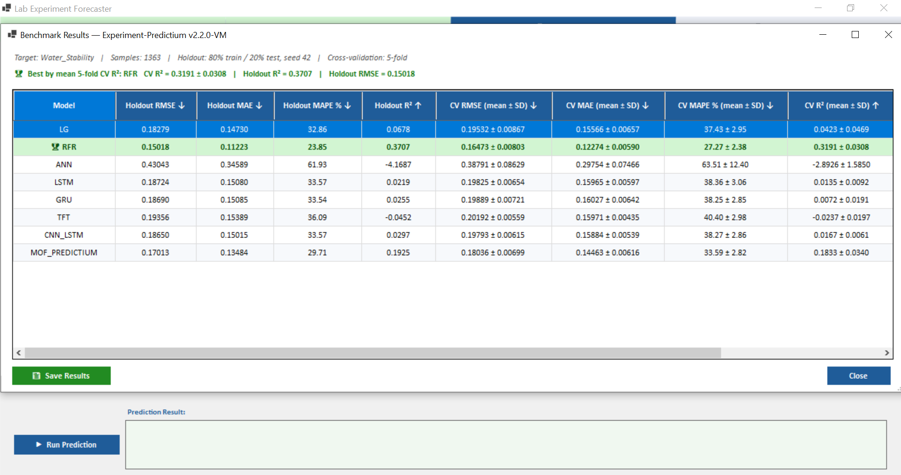

**Figure 4. Eight-model benchmark.** Models are evaluated under a common workflow so that model selection is based on comparable evidence rather than isolated runs.

---

## 5. Interpretability

The interpretation workflow is designed to help researchers investigate which input features are influencing model predictions.

Depending on the selected model and available dependencies, the software can provide:

- feature-importance analysis;
- SHAP-based interpretation;
- graphical feature ranking;
- automatically generated explanatory text;
- exportable figures.

Interpretability results describe **model behaviour**, not experimental causality.

<!-- SCREENSHOT: save as image/screenshots/05_interpretability.png -->
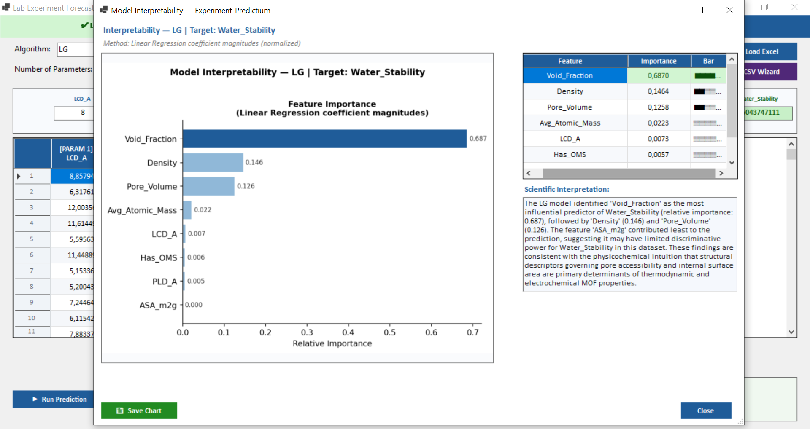

---

## 6. PDF scientific report

Experiment-Predictium can generate an analysis report bringing together dataset information, model results, visualisations, interpretation, and prediction outputs.

This is intended to reduce manual copying between analysis software and supplementary/reporting documents.

<!-- SCREENSHOT: save as image/screenshots/06_pdf_report.png -->
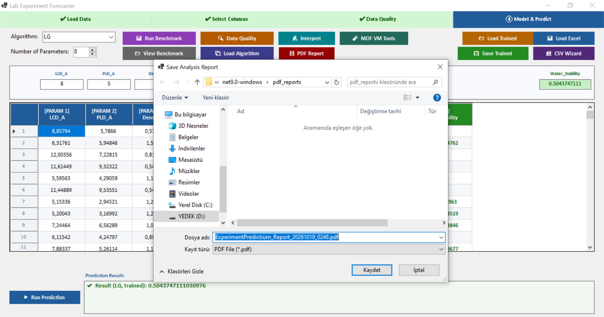

---

# Machine-learning models

The current release contains **eight built-in model options**.

| Model | Full name | Primary role in Experiment-Predictium |
|---|---|---|
| `LG` | Linear Regression | Simple transparent baseline |
| `RFR` | Random Forest Regressor | Tree-based nonlinear ensemble baseline |
| `ANN` | Artificial Neural Network | Feed-forward nonlinear regression |
| `LSTM` | Long Short-Term Memory | Sequence-oriented neural architecture |
| `GRU` | Gated Recurrent Unit | Compact gated recurrent architecture |
| `TFT` | Temporal Fusion Transformer baseline | Attention-oriented sequence model |
| `CNN_LSTM` | Convolutional Neural Network + LSTM | Combined feature extraction and recurrent modelling |
| `MOF_PREDICTIUM` | MOF-Predictium hybrid | MOF-focused hybrid experimental architecture |

The presence of multiple architectures is intentional. A more complex model is **not assumed to be better**; users are encouraged to compare models using held-out and cross-validation evidence.

---

# MOF-Predictium

**MOF-Predictium** was implemented during the EU4MOFs Virtual Mobility work as the eighth built-in model option.

Its hybrid workflow combines:

1. **1D convolutional feature extraction** for local patterns in ordered descriptor sequences;
2. **multi-head self-attention** for global feature dependencies;
3. **gradient-boosted residual correction** to compensate for systematic prediction residuals in tabular data.

The purpose of the architecture is not to assume that deep learning must outperform simpler methods. It provides an additional hypothesis that can be tested under the same benchmark as LG, RFR, ANN, LSTM, GRU, TFT and CNN-LSTM.

<!-- SCREENSHOT: save as image/screenshots/07_mof_predictium_selected.png -->
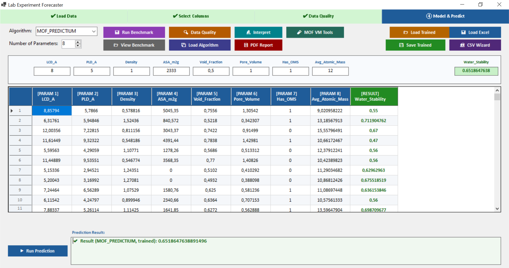

**Important:** scientific performance claims should be made only from frozen datasets, explicit train/test rules, complete provenance, and preserved result files.

---

# MOF VM Tools

The **MOF VM Tools** window extends the original prediction workflow into materials-informatics validation, screening and reproducibility tasks.

<!-- SCREENSHOT: save as image/screenshots/08_mof_vm_tools.png -->
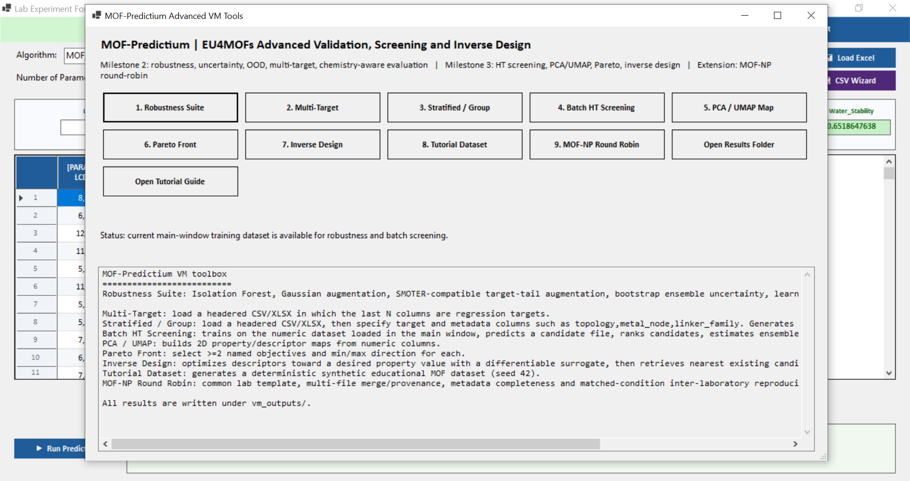

The current tools are:

## 1. Robustness Suite

The robustness workflow combines several checks that help determine whether apparently good predictive performance is trustworthy.

It includes:

- **Isolation Forest anomaly detection**;
- **Gaussian-noise augmentation**;
- **SMOTER-compatible target-tail augmentation**;
- **bootstrap ensemble uncertainty estimation**;
- **learning-curve analysis**;
- **descriptor-space out-of-distribution (OOD) detection**.

The intention is to answer not only *“What is the prediction?”* but also *“How much should I trust this prediction under the available training data?”*

<!-- SCREENSHOT: save as image/screenshots/09_robustness_suite.png -->
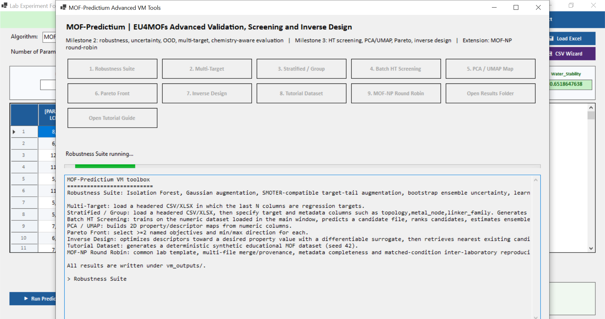

---

## 2. Multi-Target Prediction

The platform can analyse datasets containing multiple regression targets, allowing related material properties to be modelled in a common workflow.

Example applications can include simultaneous modelling of multiple adsorption, stability, electrochemical, or physical-property targets when suitable labelled data are available.

---

## 3. Stratified / Group Evaluation

Random train/test splits can make performance appear stronger when chemically similar materials occur in both training and test sets.

The group-evaluation module therefore supports metadata-aware evaluation using fields such as:

- topology;
- metal node;
- linker family;
- other user-defined grouping variables.

It also supports **leave-one-group-out evaluation**, which is useful for testing whether a model generalises beyond a chemistry group represented during training.

<!-- SCREENSHOT: save as image/screenshots/10_stratified_evaluation.png -->
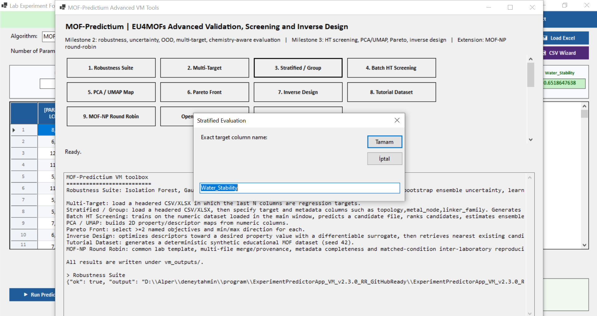

---

## 4. Batch High-Throughput Screening

A trained model can be applied to a candidate table in batch mode.

The workflow can:

- predict the selected target for many candidate rows;
- rank candidates by a maximise/minimise objective;
- estimate ensemble dispersion;
- flag candidates outside the training descriptor domain;
- export ranked results.

This is intended as a **candidate-prioritisation layer**, not a replacement for experimental or high-fidelity computational validation.

<!-- SCREENSHOT: save as image/screenshots/11_ht_screening.png -->
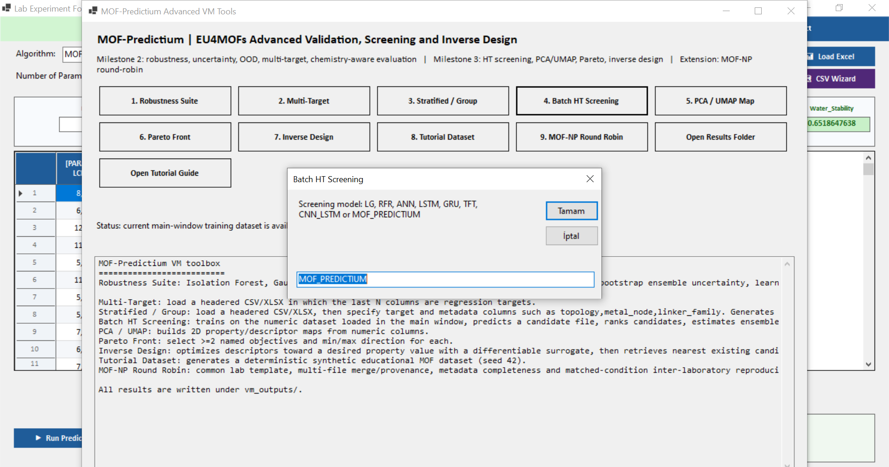

---

## 5. PCA / UMAP Property-Space Mapping

High-dimensional descriptor tables can be projected into two dimensions using:

- **PCA**;
- **UMAP**.

Points can be coloured by a selected property to help researchers inspect clustering, coverage, possible outliers, and underrepresented regions of descriptor space.

<!-- SCREENSHOT: save as image/screenshots/12_pca_umap.png -->
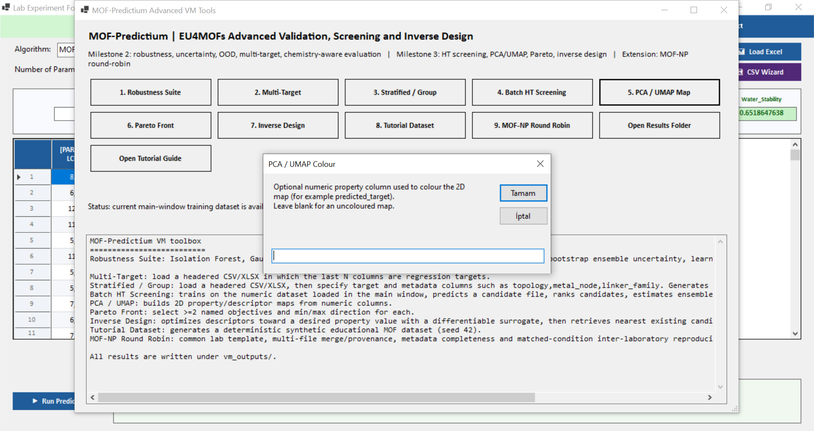

---

## 6. Pareto-Front Multi-Objective Analysis

Materials optimisation frequently involves competing objectives rather than a single property.

The Pareto module supports two or more objectives with user-defined `max` / `min` directions and identifies non-dominated candidates.

Example conceptual use cases include:

- maximise adsorption while minimising another undesirable property;
- maximise electrochemical performance while minimising instability;
- balance multiple material-selection criteria rather than ranking candidates by one score.

<!-- SCREENSHOT: save as image/screenshots/13_pareto_front.png -->
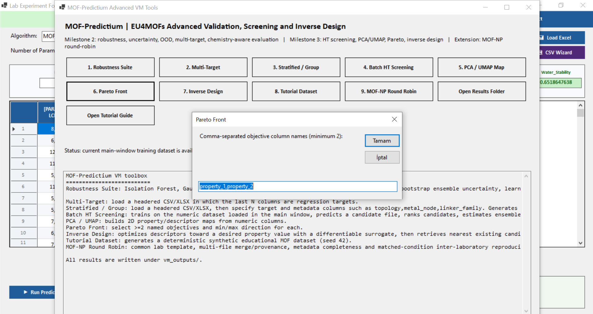

---

## 7. Gradient-Based Inverse Design + Candidate Retrieval

The inverse-design workflow starts with a desired target property and searches descriptor space using a differentiable surrogate. The resulting descriptor target is then linked back to the nearest existing candidates in the supplied candidate table.

Conceptually:

**desired property → descriptor-space optimisation → nearest known candidates → experimental/computational validation**

This design deliberately separates *optimisation in model space* from *claims that a hypothetical material is synthetically feasible*.

<!-- SCREENSHOT: save as image/screenshots/14_inverse_design.png -->
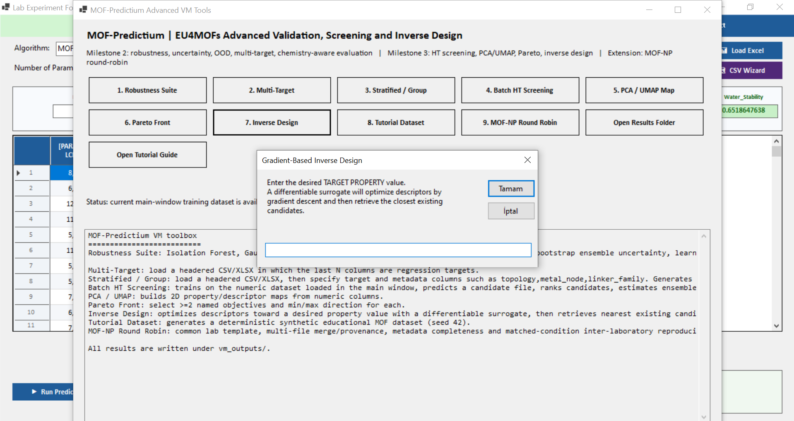

---

## 8. Tutorial Dataset Generator

A deterministic synthetic tutorial dataset is included to demonstrate software operation without presenting synthetic data as experimental evidence.

The tutorial material is intended for:

- learning the user interface;
- checking installation;
- demonstrating the end-to-end workflow;
- software smoke testing;
- reproducibility training.

Synthetic tutorial results **must not be cited as real MOF measurements**.

---

# MOF-NP Round-Robin and Inter-Laboratory Reproducibility

Version `2.3.0-VM-RR` introduces a dedicated **MOF-NP Round-Robin & Inter-Laboratory Reproducibility** module.

This extension was motivated by scientific discussions within the EU4MOFs network concerning the need for reproducible, multi-laboratory evaluation of **MOF nanoparticle toxicity and related measurements**.

The module is designed to provide the **data-coordination and statistical-analysis layer** for a future round-robin study. It does **not** perform toxicology experiments and is **not an official EU4MOFs experimental protocol**.

<!-- SCREENSHOT: save as image/screenshots/15_round_robin_home.png -->
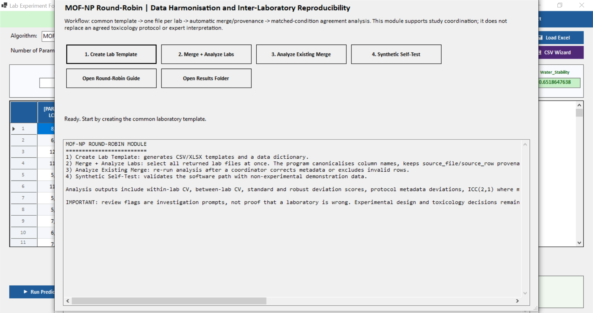

## What the module does

The round-robin module can:

- create a shared CSV/XLSX laboratory template;
- create a data dictionary explaining every field;
- merge many laboratory files automatically;
- preserve `source_file` and `source_row` provenance;
- harmonise a controlled set of column aliases;
- harmonise only explicitly supported dose units;
- retain original values and units;
- calculate metadata completeness;
- construct matched experimental conditions;
- calculate per-laboratory replicate mean and SD;
- calculate within-laboratory CV;
- calculate between-laboratory CV;
- calculate standard deviation scores;
- calculate median/MAD robust deviation scores;
- report protocol/metadata differences;
- calculate **ICC(2,1) absolute agreement** where the data structure supports it;
- calculate pairwise laboratory correlations where sufficient overlap exists;
- flag discordant laboratory-condition combinations for review;
- generate CSV, JSON, Markdown and graphical outputs.

A review flag is an **investigation signal**, not evidence that a laboratory made an error.

---

# How to combine data returned by independent laboratories

The preferred workflow is intentionally designed to avoid manual Excel copy/paste.

## Step 1 — Create one common study template

From:

`MOF VM Tools → 9. MOF-NP Round Robin → Create Lab Template`

The coordinator creates the common template and distributes the **same field structure** to every participating laboratory.

Typical fields include:

| Category | Example fields |
|---|---|
| Study identity | `study_id`, `protocol_version`, `lab_id` |
| Material identity | `material_id`, `batch_id`, `mof_name`, `metal_node`, `linker` |
| Nanoparticle identity | `particle_size_nm`, `hydrodynamic_size_nm`, `PDI`, `zeta_potential`, `morphology`, `surface_modification` |
| Biological context | `cell_line`, `medium`, `serum_percent` |
| Experimental design | `assay`, `endpoint`, `dose_value`, `dose_unit`, `exposure_h`, `replicate_id`, `control` |
| Result | `result_value`, `result_unit` |
| Traceability | `instrument`, `notes` |

The same `study_id`, agreed material/batch identifiers, and protocol version should be used across participating laboratories where scientifically appropriate.

A pseudonymous `lab_id` may be used when analysis should be blinded.

<!-- SCREENSHOT: save as image/screenshots/16_round_robin_template.png -->
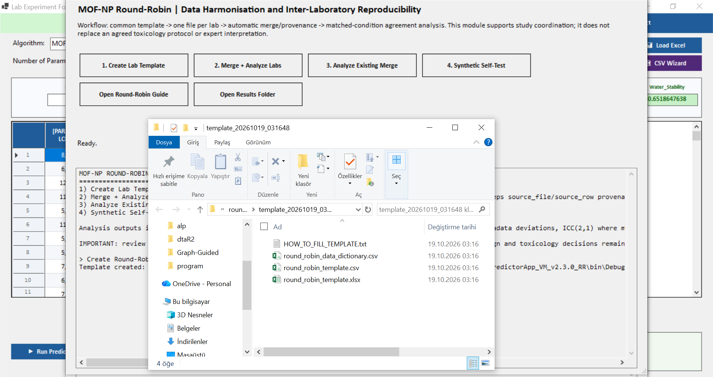

## Step 2 — Each laboratory records one replicate per row

Each laboratory completes its own file independently.

Example:

```text
Lab_A.xlsx
Lab_B.xlsx
Lab_C.xlsx
Lab_D.xlsx
Lab_E.xlsx
```

The raw laboratory submissions should be retained unchanged for provenance.

## Step 3 — Merge all returned files

Select:

`Merge + Analyze Labs`

Then multi-select all returned CSV/XLSX files.

The software creates a merged table and adds source provenance so every merged row can be traced back to the original file and row.

Primary merge outputs are stored under:

```text
vm_outputs/
└── round_robin/
    ├── 01_merge/
    │   ├── merged_round_robin.csv
    │   ├── metadata_completeness.csv
    │   └── merge_report.json
    └── 02_analysis/
        └── ...
```

Before interpreting reproducibility statistics, the coordinator should review:

- `merge_report.json`;
- `metadata_completeness.csv`;
- unit consistency;
- protocol-version consistency;
- missing required fields.

<!-- SCREENSHOT: save as image/screenshots/17_round_robin_merge.png -->
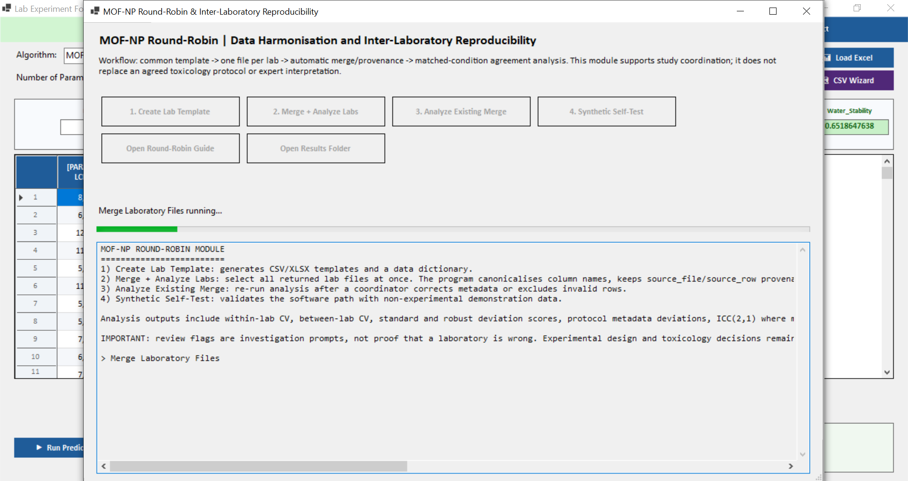

## Step 4 — Compare only matched conditions

The software does not treat scientifically different conditions as equivalent simply because they concern the same MOF.

For example, these should **not** automatically be pooled:

```text
ZIF-8 | A549 | CCK-8 | 50 µg/mL | 24 h
ZIF-8 | A549 | MTT   | 50 µg/mL | 24 h
ZIF-8 | A549 | CCK-8 | 50 µg/mL | 48 h
ZIF-8 | HepG2| CCK-8 | 50 µg/mL | 24 h
```

A round-robin comparison should preserve scientifically relevant context such as:

**material + batch + cell model + assay + endpoint + dose + exposure + unit + protocol metadata**

## Step 5 — Interpret within-lab and between-lab reproducibility

The analysis distinguishes:

### Within-laboratory variability

How repeatable are replicate measurements inside the same laboratory?

Typical outputs:

- replicate mean;
- standard deviation;
- within-lab coefficient of variation (CV).

### Between-laboratory variability

How similar are results obtained by independent laboratories under matched conditions?

Typical outputs:

- inter-laboratory mean;
- inter-laboratory SD;
- between-lab CV;
- median and IQR;
- deviation scores;
- ICC when mathematically appropriate;
- pairwise correlation when sufficient common conditions are available.

<!-- SCREENSHOT: save as image/screenshots/18_round_robin_analysis.png -->
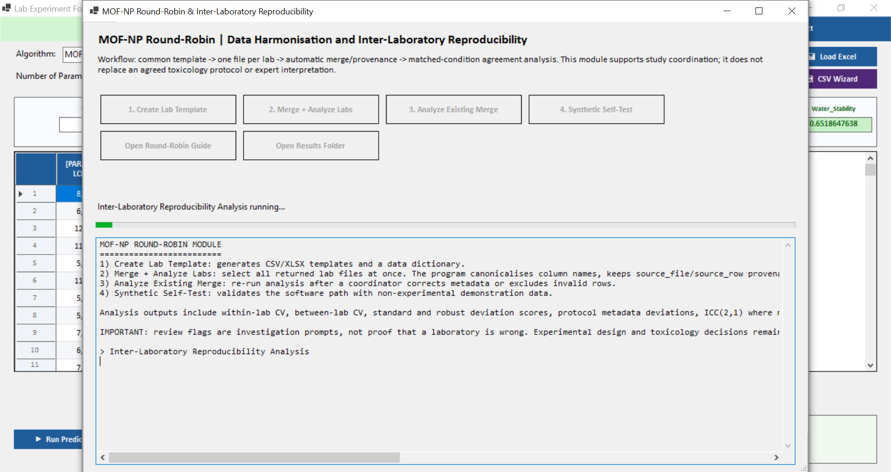

## Step 6 — Investigate discordance rather than deleting it

If one laboratory differs strongly from the others, the first question should not be *“Which result should we delete?”*

Instead, researchers can examine:

- protocol deviations;
- batch differences;
- particle-size changes;
- aggregation/dispersion differences;
- cell-culture conditions;
- assay differences;
- medium/serum conditions;
- instrument differences;
- unit or transcription errors;
- missing metadata.

The software is designed to help expose such differences while leaving the scientific interpretation to the participating researchers.

For full instructions, see:

[`docs/MOF_NP_ROUND_ROBIN_GUIDE.md`](docs/MOF_NP_ROUND_ROBIN_GUIDE.md)

---

# Typical scientific workflows

## General experimental prediction

```text
Excel/CSV data
     ↓
Data Quality / CSV Wizard
     ↓
Train + Benchmark models
     ↓
Prediction
     ↓
Interpretability
     ↓
Save model / PDF report
```

## MOF property modelling

```text
Curated MOF descriptor/property table
     ↓
Data-quality and provenance checks
     ↓
8-model benchmark + 5-fold CV
     ↓
Uncertainty + OOD + learning curves
     ↓
Topology / metal-node / linker group tests
     ↓
Scientific model selection
```

## High-throughput candidate prioritisation

```text
Labelled training table
     ↓
Validated model
     ↓
Candidate descriptor table
     ↓
Batch prediction
     ↓
OOD + uncertainty checks
     ↓
Ranking
     ↓
PCA / UMAP + Pareto analysis
     ↓
Candidate shortlist
     ↓
Experimental or high-fidelity computational validation
```

## Inverse-design workflow

```text
Desired property value
     ↓
Differentiable surrogate
     ↓
Descriptor-space optimisation
     ↓
Nearest existing candidates
     ↓
Validation
```

## MOF nanoparticle round-robin workflow

```text
Common SOP + shared data template
        ↓
Independent laboratories
        ↓
Returned CSV/XLSX files
        ↓
Automatic merge + provenance
        ↓
Metadata completeness
        ↓
Matched-condition construction
        ↓
Within-lab + between-lab reproducibility
        ↓
Discordance / protocol review
        ↓
Reproducible study outputs
```

---

# Screenshots

For a complete visual GitHub presentation, save screenshots under:

```text
image/screenshots/
```

Recommended filenames:

```text
01_main_interface.png
02_data_quality.png
03_csv_wizard.png
04_benchmark_8_models.png
05_interpretability.png
06_pdf_report.png
07_mof_predictium_selected.png
08_mof_vm_tools.png
09_robustness_suite.png
10_stratified_evaluation.png
11_ht_screening.png
12_pca_umap.png
13_pareto_front.png
14_inverse_design.png
15_round_robin_home.png
16_round_robin_template.png
17_round_robin_merge.png
18_round_robin_analysis.png
```

For publication-quality documentation, screenshots should avoid showing personal directories, private filenames, email addresses, API keys, or other sensitive information.

---

# Installation

## System requirements

- Windows 10/11;
- **.NET 9.0**;
- Microsoft Visual Studio 2022 for source development;
- Python 3.9+;
- recommended: 64-bit Python.

## Python dependencies

From the repository root:

```bash
py -m pip install -r python_scripts/requirements.txt
```

The current requirements include:

```text
numpy
pandas
scikit-learn
torch
matplotlib
openpyxl
joblib
shap
umap-learn
xlrd
```

## Prebuilt Windows release

The `v2.3.0-VM-RR` release includes a Windows package containing `ExperimentPredictorApp.exe` together with the application DLLs, Python scripts, documentation, and tutorial files. Extract the entire ZIP before running the application; do not copy only the `.exe`.

The current prebuilt package requires:

- .NET 9 Desktop Runtime (x64);
- Python 3.9+ (64-bit recommended);
- Python packages listed in `python_scripts/requirements.txt`.

After extraction, run `install_python_dependencies.bat` once, then start `ExperimentPredictorApp.exe`.

> The Windows package uses the system .NET 9 Desktop Runtime and Python environment described above.

## Build from source

1. Open `ExperimentPredictorApp.sln` in Visual Studio 2022.
2. Ensure the `.NET Desktop Development` workload and .NET 9 SDK are installed.
3. Select **Build → Rebuild Solution**.
4. Run `ExperimentPredictorApp` using the green Start button.

---

# Reproducibility

The repository includes dedicated documentation and scripts for reproducibility.

Important files include:

- [`REPRODUCIBILITY.md`](REPRODUCIBILITY.md)
- [`docs/EU4MOFS_TUTORIAL.md`](docs/EU4MOFS_TUTORIAL.md)
- [`docs/MOF_NP_ROUND_ROBIN_GUIDE.md`](docs/MOF_NP_ROUND_ROBIN_GUIDE.md)
- `reproducibility/run_vm_demo.py`
- `tutorial_data/`

The tutorial dataset is deterministic synthetic data for software demonstration. It is intentionally separated from experimental claims.

For publishable scientific analyses, preserve at minimum:

- exact dataset version;
- source DOI/repository;
- inclusion/exclusion criteria;
- feature definitions;
- target provenance;
- train/test split strategy;
- random seed;
- software release/version;
- generated result tables;
- model files where appropriate;
- analysis configuration.

---

# Data resources and CoRE MOF

The EU4MOFs Virtual Mobility work was designed around **CoRE MOF DB-derived tabular workflows** and other appropriately curated MOF property datasets.

CoRE MOF database resources are **independent scientific/community data resources** and should be cited according to the relevant database release and licensing requirements.

For scientific studies using CoRE MOF 2025, the exact database release, accessible structures, descriptor-generation procedure, property-label availability, filtering rules, split design, and generated result files should be documented and archived alongside the analysis.

CoRE MOF 2025 resource used in the VM planning:

- Zenodo record: <https://zenodo.org/records/15621349>

---

# Broader research relevance

Although the EU4MOFs Virtual Mobility work focuses on MOF data, the software architecture is intentionally transferable across experimental and computational materials research.

## Energy-storage materials

Potential applications include:

- battery-material property prediction;
- supercapacitor-electrode screening;
- electrochemical performance modelling;
- degradation and ageing analysis;
- anomaly detection;
- uncertainty-aware prediction;
- multi-objective materials selection;
- reproducible comparison of competing ML architectures.

## Sustainable and resilient energy systems

The same methodological framework can support broader research connecting **materials informatics, battery performance, safety, and resilient electric mobility**.

Examples include:

- screening materials for energy-storage applications;
- identifying robust models for battery-performance prediction;
- analysing sensor or degradation anomalies;
- quantifying prediction uncertainty before operational decisions;
- balancing competing performance/safety objectives;
- supporting evidence-based research on reliable battery systems and resilient charging/mobility infrastructure.

This relationship is methodological: Experiment-Predictium is a research platform that can support such studies when appropriate datasets and validation protocols are supplied. It should not be interpreted as an operational charging-control or emergency-management system by itself.

## Research accessibility and public value

A central objective of Experiment-Predictium is to reduce the computational barrier between experimental researchers and modern machine-learning methods.

The project therefore emphasises:

- no-code access;
- open-source distribution;
- transparent model comparison;
- reproducibility;
- uncertainty and domain-awareness;
- transferable workflows across scientific fields;
- reusable data templates and analysis outputs;
- interoperability between experimental and computational research.

These features are intended to make data-driven methods more accessible to laboratories that possess valuable experimental datasets but may not have dedicated ML software-development expertise.

---

# Scientific scope and limitations

Experiment-Predictium is a **research software platform**.

It is not intended to replace:

- experimental validation;
- domain-expert interpretation;
- molecular simulation where high-fidelity simulation is required;
- toxicology expertise;
- regulatory safety assessment;
- clinical decision-making;
- formal laboratory accreditation procedures.

Specific cautions:

### Machine-learning performance

Performance is dataset-dependent. Results from one target, split, chemistry family, or dataset should not automatically be generalised to another.

### SHAP / feature importance

Feature importance describes model behaviour and association; it does not establish causality.

### OOD detection

An OOD flag means that a candidate appears different from the training domain according to the implemented descriptor-space method. It is a warning, not proof that the material is invalid.

### Inverse design

Optimised descriptor combinations are model-space suggestions. Synthetic feasibility must be assessed separately. The nearest-candidate retrieval stage is included to reconnect optimisation to known candidate rows.

### MOF toxicity / round robin

The round-robin module provides data harmonisation and reproducibility analysis. It is **not a toxicity diagnostic tool**, and it does not define an official toxicology protocol.

### Synthetic tutorial data

Synthetic data are provided only for demonstration and software verification. They must not be reported as experimental scientific evidence.

---

# COST Action CA22147 / EU4MOFs support

The MOF-specific development of Experiment-Predictium was advanced during the Virtual Mobility activity:

> **MOF-Predictium: A No-Code Machine Learning Platform for MOF Property Prediction, Benchmarking, and High-Throughput Screening Using CoRE MOF DB**

within:

> **COST Action CA22147 – EU4MOFs**

The Virtual Mobility activity received **financial support through a COST Virtual Mobility Grant awarded to Alper Bingöl**.

**Grant reference:** `E-COST-GRANT-CA22147-6e4f1131`

The work also benefited from scientific interaction and feedback within the EU4MOFs network, particularly around MOF data analysis, computational workflows, stability-related data, biomedical/toxicity data structuring, and the concept of future inter-laboratory MOF nanoparticle reproducibility studies.

The MOF-NP round-robin functionality in this repository should be understood as a **research-software extension inspired by those scientific discussions**, not as an officially adopted EU4MOFs protocol or as evidence that the future experimental study has already been performed.

### Funding/data distinction

COST support and scientific data resources should be distinguished clearly:

- **COST Action CA22147 / EU4MOFs:** supported the Virtual Mobility activity financially and provided the international scientific-network context in which the MOF-specific development was advanced.
- **CoRE MOF and other scientific datasets:** are separate scientific/community resources used or targeted by the analytical workflow and should be acknowledged/cited according to their own publications, repositories, licences, and provenance.

This distinction is important for accurate scientific attribution.

---

# Repository structure

A simplified overview:

```text
ExperimentPredictorApp/
│
├── ExperimentPredictorApp.sln
├── ExperimentPredictorApp.csproj
├── MainForm.cs
├── BenchmarkForm.cs
├── DataQualityForm.cs
├── ExplainForm.cs
├── AdvancedMofToolsForm.cs
├── RoundRobinForm.cs
│
├── python_scripts/
│   ├── requirements.txt
│   └── ... ML / MOF / round-robin scripts
│
├── docs/
│   ├── EU4MOFS_TUTORIAL.md
│   ├── WATER_STABILITY_DATA_FRAMEWORK.md
│   ├── MOF_TOXICITY_DATABASE_FRAMEWORK.md
│   └── MOF_NP_ROUND_ROBIN_GUIDE.md
│
├── tutorial_data/
├── reproducibility/
├── image/
│   └── screenshots/
│
├── REPRODUCIBILITY.md
├── CHANGELOG_VM_2.3.0.md
├── VERSION
└── LICENSE
```

---

# Related documentation

| Document | Purpose |
|---|---|
| [`docs/EU4MOFS_TUTORIAL.md`](docs/EU4MOFS_TUTORIAL.md) | Step-by-step MOF-oriented tutorial |
| [`docs/WATER_STABILITY_DATA_FRAMEWORK.md`](docs/WATER_STABILITY_DATA_FRAMEWORK.md) | Water-stability data structuring framework |
| [`docs/MOF_TOXICITY_DATABASE_FRAMEWORK.md`](docs/MOF_TOXICITY_DATABASE_FRAMEWORK.md) | Structured MOF nanoparticle toxicity-data framework |
| [`docs/MOF_NP_ROUND_ROBIN_GUIDE.md`](docs/MOF_NP_ROUND_ROBIN_GUIDE.md) | Multi-laboratory template, merge and reproducibility guide |
| [`REPRODUCIBILITY.md`](REPRODUCIBILITY.md) | Reproducibility principles and execution notes |

---

# Citation

If you use Experiment-Predictium in academic work, please cite the archived Zenodo release and the software repository.

Current repository:

```text
Bingöl, A. (2026). Experiment-Predictium v2.3.0-VM-RR: A No-Code Scientific Machine Learning Platform with MOF-Predictium, High-Throughput Screening, and Inter-Laboratory Reproducibility Tools. Zenodo. https://doi.org/10.5281/zenodo.23462328

GitHub: https://github.com/abscienceai/Experiment-Predictium
```

**Release DOI:** `10.5281/zenodo.23462328`  
**Concept DOI (all versions):** `10.5281/zenodo.18215803`

For analyses using CoRE MOF or another external dataset, cite that dataset independently in addition to the software.

---

# Author

**Alper Bingöl**  
Department of Physics, İnönü University, Türkiye  
EU4MOFs CA22147 – WG3 & WG4  
ORCID: `0009-0003-4437-2439`

GitHub: <https://github.com/abscienceai>

Research interests include experimental energy-storage materials, electrochemical characterisation, materials informatics, machine learning for scientific data, MOFs, battery/supercapacitor research, and data-driven tools for sustainable and resilient energy systems.

---

# Contributing

Scientific users are welcome to contribute:

- reproducible bug reports;
- new scientific datasets with clear provenance/licensing;
- model implementations;
- validation workflows;
- documentation improvements;
- inter-laboratory data-template feedback;
- benchmark results that include complete data/split provenance.

For a scientific feature request, please describe the experimental/computational use case, expected input fields, desired output, and validation criteria.

---

# License

Experiment-Predictium is released under the **MIT License**. See [`LICENSE`](LICENSE).

---

## Acknowledgment text for publications or presentations

A concise acknowledgment may be written as:

> **The MOF-specific development of Experiment-Predictium was supported through a Virtual Mobility Grant within COST Action CA22147 (EU4MOFs). The authors also acknowledge the independent scientific data resources and community datasets used in the respective analyses, which should be cited according to their original sources.**

---

## Project principle

> **Prediction is useful only when the researcher can also see how the model was evaluated, where it may fail, and whether the new sample resembles the data on which the model learned.**
